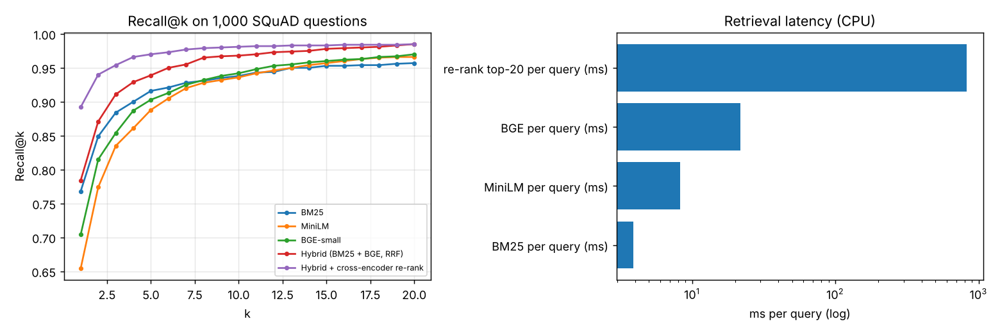
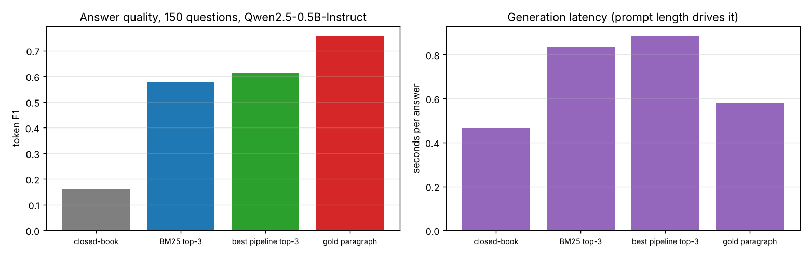

# How much does retrieval matter for a small local LLM? A RAG ablation on SQuAD

[](https://colab.research.google.com/github/Ashhar-Hussain/rag-retrieval-ablation/blob/main/rag_retrieval_ablation.ipynb)
   

Retrieval-augmented generation is usually judged end to end, which hides where answers are won or lost. Here the 2,067 SQuAD v1.1 validation paragraphs are the knowledge base and every question has exactly one gold paragraph, so retrieval is scored on its own before a 0.5 B-parameter LLM, running locally, ever sees it.

## Retrieval (1,000 questions, 95% bootstrap CI for MRR)

| retriever | Recall@1 | Recall@5 | Recall@10 | MRR@10 |
|---|---:|---:|---:|---:|
| BM25 | 0.768 | 0.916 | 0.938 | 0.830 [0.810, 0.850] |
| MiniLM | 0.654 | 0.888 | 0.936 | 0.753 [0.730, 0.776] |
| BGE-small | 0.704 | 0.903 | 0.942 | 0.789 [0.767, 0.810] |
| Hybrid (BM25 + BGE, RRF) | 0.784 | 0.939 | 0.968 | 0.851 [0.833, 0.870] |
| Hybrid + cross-encoder re-rank | 0.892 | 0.970 | 0.981 | 0.926 [0.911, 0.939] |

## Generation (150 questions, `Qwen/Qwen2.5-0.5B-Instruct`, greedy)

| context given to the model | EM | F1 | abstained | s / answer | prompt tokens |
|---|---:|---:|---:|---:|---:|
| closed-book | 0.080 | 0.163 | 0% | 0.47 | 34 |
| BM25 top-3 | 0.473 | 0.579 | 1% | 0.83 | 572 |
| best pipeline top-3 | 0.487 | 0.612 | 0% | 0.88 | 570 |
| gold paragraph | 0.633 | 0.756 | 1% | 0.58 | 222 |

Paired bootstrap on the same questions:

| comparison | F1 difference | 95% CI |
|---|---:|---:|
| best pipeline top-3 vs BM25 top-3 | +0.033 | [-0.024, +0.089] |
| BM25 top-3 vs closed-book | +0.416 | [+0.338, +0.495] |
| gold paragraph vs best pipeline top-3 | +0.144 | [+0.095, +0.198] |

**What this shows.** Re-ranking raised Recall@1 by +0.124 over BM25, but answer F1 moved by only +0.033, an interval that includes zero. The reader is the bottleneck: when the best pipeline's top 3 contained the gold paragraph (145 of 150 questions), F1 was 0.626, below the 0.756 the same model reaches with the gold paragraph alone, which suggests the two extra paragraphs distract a 0.5 B model. Retrieval misses are still costly. When BM25 missed the gold paragraph (25 of 150 questions) F1 fell from 0.657 to 0.187, and the model abstained on 0 of them; for the best pipeline the numbers are 5 misses, F1 0.626 → 0.200, 0 abstentions. A miss becomes a confident wrong answer, not a refusal, so an answerability check is worth adding before shipping a small-model RAG system.




Latency on 2 CPU cores: BM25 3.9 ms, BGE-small 21.9 ms and cross-encoder re-ranking of 20 candidates 827 ms per query; generation dominates end-to-end time.

## Method

BM25 (Okapi), `all-MiniLM-L6-v2` and `bge-small-en-v1.5` dense retrieval with exact cosine search, reciprocal rank fusion (k = 60), cross-encoder re-ranking (`ms-marco-MiniLM-L6-v2`); `Qwen2.5-0.5B-Instruct` with a prompt that asks for a short span or "unanswerable"; official SQuAD normalisation for EM/F1; paired bootstrap (2,000 resamples) for every comparison. Generations are written to a JSONL file as they are produced, so an interrupted run resumes where it stopped.

## Run it

Colab badge above (any runtime; a GPU makes generation fast), or locally:

```bash
pip install -r requirements.txt
jupyter nbconvert --to notebook --execute rag_retrieval_ablation.ipynb
```

## Citation

```bibtex
@software{hussain2026ragretrievalablati,
  author  = {Hussain, Ashhar},
  title   = {How much does retrieval matter for a small local LLM? A RAG ablation on SQuAD},
  year    = {2026},
  url     = {https://github.com/Ashhar-Hussain/rag-retrieval-ablation},
  version = {1.0.0}
}
```

## License

Code: MIT. SQuAD: CC BY-SA 4.0. Models: see their Hugging Face model cards.
